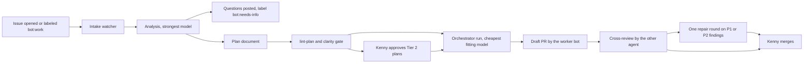

# Issue worker bots: design

Status: draft for Kenny's review. Nothing here is built yet.

## Goal

When an issue is opened in one of Kenny's repositories, a bot picks it up, works out what to do, writes the code, and opens a pull request, all under a bot identity. The expensive models do the thinking; cheaper models do the typing once the plan is clear. Claude and Codex each get a worker bot, and every pull request a worker opens is reviewed by the other agent's review bot from `pr-review-bots`.

## What already exists

Most of the machinery is already in [openclaw-ecc-orchestrator](https://github.com/kennylhilljr/openclaw-ecc-orchestrator). These bots should drive it, not rebuild it.

| Need | Already there |
| --- | --- |
| Turn a plan into checked work units | Plan documents with units, file scopes and acceptance commands; `lint-plan` rejects bad plans (PR 15) |
| Pick a model by difficulty | Routing classifies each unit into Tier 0, 1 or 2 from its traits and paths, then picks the cheapest healthy runner and model for that tier from `policy.cli_models` |
| Use a bigger model only when needed | The escalation controller moves a unit up one tier after an objective failure (tests fail), within the unit's cost and time budget |
| Keep work isolated | Each unit runs in its own Git worktree |
| Stop on quota or outages | The circuit breaker takes a failing runner out of selection |
| Independent review of risky work | Tier 2 and high-risk units need a reviewer from a different model family |
| Bot identities, tokens, pushes, cross-review | `pr-review-bots`: `prbot`, the watcher and the guard hooks |

What is missing is the front end: noticing issues, the analysis step, turning analysis into a plan, and opening the pull request as a bot.

## Identities

Two new GitHub Apps, separate from the review bots:

| | Claude worker | Codex worker |
| --- | --- | --- |
| App name (proposed) | `claude-dev-gh` | `codex-dev-gh` |
| Does | Analyzes issues, writes code, opens PRs | Same |
| Reviewed by | `codex-pr-gh` | `claude-pr-gh` |
| Permissions | Contents, pull requests and issues: read and write | Same |

Keeping workers and reviewers apart means a pull request's author and its reviewer are visibly different accounts, and each App holds only what it needs. Once the workers exist, the review bots can go back to contents read-only, since agents would push through the worker bots.

Registration, tokens, Keychain storage and the bot commit identity all come from `prbot`. It needs one change: bot names are fixed to `claude` and `codex` today, and it would need to accept `claude-dev` and `codex-dev` as well.

## Which issues get picked up

Kenny's repositories are public, so anyone can open an issue. An issue's text goes into a model's prompt, so a stranger's issue is a prompt-injection risk. The bots act only on:

- issues opened by `kennylhilljr`, or
- issues where `kennylhilljr` adds the label `bot:work`.

Everything else is ignored. The text of an accepted issue is still treated as a task description, never as instructions that can change the bots' rules, tools or permissions.

Skipped as well: issues assigned to a person, issues labeled `bot:skip`, and repositories without a test command (there is no objective check for the coding step).

## Which agent takes an issue

1. A label `agent:claude` or `agent:codex` on the issue decides.
2. Otherwise the agent with quota left and a closed circuit breaker takes it. When both are available, alternate, so neither subscription runs out first.
3. The same agent does the analysis and the coding for one issue, so the pull request has a single author and the other agent can review it.

## The pipeline

### 1. Intake

A launchd job, like the review watcher, checks every 5 minutes for issues that qualify. It labels the issue `bot:analyzing`, comments once ("Picked up by claude-dev-gh"), and records the issue in a state file so restarts don't repeat work.

### 2. Analysis (expensive model, read-only)

The strongest model reads the issue, the repository and recent history, read-only, and returns exactly one of:

- **Questions.** The issue is ambiguous. The bot posts the questions as a comment, labels the issue `bot:needs-info`, and stops. A reply from Kenny restarts analysis.
- **A plan.** An orchestrator plan document: units, the files each unit may touch, acceptance commands that prove it done, declared traits (`mechanical`, `security`, `database` and so on), and dependencies between units.

The plan's summary is posted on the issue, so Kenny can see what the bot intends before code exists.

### 3. Clarity gate

This is what lets cheap models do the coding. A unit counts as clear when:

- `lint-plan` passes for the whole plan;
- every unit has at least one acceptance command;
- every unit names the files it may change, and they exist or are explicitly new;
- the analysis left no open questions;
- the unit description says what to change, not only what is wrong.

Clear units start at Tier 0 or 1 and are coded by a cheap model. Units that fail the gate go back to analysis once with the specific failures; a second failure turns into questions on the issue.

### 4. Approval

Plans whose units are all Tier 0 or 1 run without waiting. Any Tier 2 unit (security, database, architecture, or a high-risk path) waits for Kenny to react with 👍 to the plan comment or add `bot:approved`. The orchestrator's existing risk rules decide the tier; the bots cannot lower it.

### 5. Coding

The worker starts an orchestrator run with the plan. The orchestrator routes each unit to the model for its tier, runs it in a worktree, runs the acceptance commands, and escalates one tier on a real failure. Commits use the worker bot's identity through `prbot git`, on a branch named `bot/<issue-number>-<slug>`.

### 6. Pull request and review

When all units pass, the worker pushes and opens a draft PR with `Closes #<n>`, the label `agent:claude` or `agent:codex`, and the plan summary. It marks the PR ready, and the `pr-review-bots` watcher sends it to the other agent for review within 5 minutes.

If the review raises P1 or P2 findings, the worker runs one repair round. Each finding becomes a unit with the finding as its instructions and the failing case as its acceptance check, which is exactly the clear kind of work a cheap model can do. After that round, or if findings remain, the PR waits for Kenny.

Merging stays with Kenny.

## Model choice

Expensive models where judgment matters, cheaper models where the instructions are clear, and escalation instead of starting big.

| Step | Claude worker | Codex worker | Why |
| --- | --- | --- | --- |
| Analysis and planning | `opus` (Opus 5.5), high effort | `gpt-6-astra`, high effort | Reading an unfamiliar codebase and splitting work well is where mistakes are costliest |
| Tier 0 coding: mechanical, small, fully specified | `haiku` (Haiku 5.5) | `gpt-5.6-terra`, low effort | Renames, fixture updates, one-function fixes with a failing test to satisfy |
| Tier 1 coding: normal, clear plan | `sonnet` (Sonnet 5.5) | `gpt-5.6-sol`, medium effort | Most units after a good plan; the older workhorse is enough when the plan is specific |
| Tier 2 coding: risky or hard | `opus` (Opus 5.5) | `gpt-6-astra` | Security, data and architecture work, or after cheaper tiers failed |
| Repair after review | Same tier as the original unit | Same | Findings are specific instructions, so the cheap tier usually suffices |
| Issue comments and status notes | `haiku` | `gpt-6-luna` | Short summaries |

These go in the orchestrator policy (`cli_models` and `model_preferences`), not in code, so swapping a model is a config change. The Codex list comes from the models the CLI reports today. On the Claude side, "older and cheaper" is better served by the smaller classes (Sonnet, Haiku) than by older Opus versions; I have no pricing data showing older Claude versions cost less on a subscription.

Two cautions:

- **Subscription quota is the real budget.** Codex is currently at its usage limit until Nov 4. Analysis on the frontier models spends quota fastest, so it runs once per issue, and re-analysis only happens on a failed gate or a reply from Kenny.
- **Measure before trusting the table.** The tiers above are a starting point. After the first 20 or so issues, compare escalation rates per tier: a tier that escalates most of the time should start one tier higher, and one that never escalates might drop a tier.

## Budgets and limits

| Limit | Default | On reaching it |
| --- | --- | --- |
| Issues in progress at once | 2 | New issues wait in `bot:queued` |
| Analysis attempts per issue | 2 | Questions posted on the issue |
| Cost or time per issue | Orchestrator unit budgets | Run stops, PR or issue labeled `bot:blocked` with the reason |
| Repair rounds after review | 1 | PR waits for Kenny |
| Units per plan | 8 | Analysis is asked to split the issue into smaller issues |

## Status labels

`bot:analyzing`, `bot:needs-info`, `bot:awaiting-approval`, `bot:in-progress`, `bot:pr-open`, `bot:blocked`, `bot:queued`. Each change also posts a one-line comment from the worker bot, so the issue timeline tells the story.

## Safety

- Only issues opened or labeled by Kenny are worked on.
- Analysis runs read-only. Coding runs only inside orchestrator worktrees, never on `main` or a checkout Kenny uses.
- Workers never merge, never push to the default branch, and never change repository settings, secrets or workflows. Changes to `.github/workflows` count as a Tier 2 unit and always need approval.
- Tokens come from `prbot`: one hour, one repository, never printed or saved.
- The guard hook and the `cross-review` skill already stop agents from posting or pushing as Kenny.

## Where it lives

A new repository, `issue-worker-bots`, holds the intake watcher, the analysis prompt and its output schema, the clarity gate, and the glue that starts orchestrator runs and opens PRs. It depends on two existing pieces:

- `openclaw-ecc-orchestrator` for plans, routing, worktrees, escalation and budgets;
- `pr-review-bots` (`prbot`) for App identities, tokens, commits, pushes and reviews.

## Build order

1. Generalize `prbot` bot names; register `claude-dev-gh` and `codex-dev-gh`.
2. Intake watcher with the opener and label rules, posting only the "picked up" comment. Run it for a few days.
3. Analysis step that posts questions or a plan, with no coding yet. Check plan quality on real issues.
4. Clarity gate and approval, then orchestrator runs and draft PRs on one low-risk repository.
5. Review hand-off and the repair round.
6. Turn on more repositories, then measure escalation rates and adjust the model table.

## Open questions for Kenny

1. App names: `claude-dev-gh` and `codex-dev-gh`, or something else?
2. Trigger: issues opened by you and the `bot:work` label, or the label only?
3. Should Tier 1 plans also wait for your 👍, at least at first?
4. All 21 repositories, or start with a list?
5. Once the workers push, should the review bots go back to contents read-only?
