# Issue worker bots: design

Status: build steps 1 to 3 are live. Step 4a (gates and plan approval) is on main behind `approval_live`. Step 4b (coding and draft PRs) is built and tested with fakes, behind `coding_live`, with `kennylhilljr/ecc-customization` as the pilot; it has not run live. Kenny's answers to the open questions are under "Decisions (2026-10-29)".

## Goal

When an issue is opened in one of Kenny's repositories, a bot picks it up, works out what to do, writes the code, and opens a pull request, all under a bot identity. The expensive models do the thinking; cheaper models do the typing once the plan is clear. Claude and Codex each get a worker bot, and every pull request a worker opens is reviewed by the other agent's review bot from `pr-review-bots`.

## What already exists

Most of the machinery is already in [openclaw-ecc-orchestrator](https://github.com/kennylhilljr/openclaw-ecc-orchestrator). These bots should drive it, not rebuild it.

| Need | Already there |
| --- | --- |
| Turn a plan into checked work units | Plan documents with units, file scopes and acceptance commands; `lint-plan` rejects bad plans (PR 15) |
| Pick a model by difficulty | Routing classifies each unit into Tier 0, 1 or 2 from its traits and paths, then picks the cheapest healthy runner and model for that tier from `policy.cli_models` |
| Use a bigger model only when needed | The escalation controller moves a unit up one tier after an objective failure (tests fail), within the unit's cost and time budget |
| Keep work isolated | Each unit runs in its own Git worktree |
| Stop on quota or outages | The circuit breaker takes a failing runner out of selection |
| Independent review of risky work | Tier 2 and high-risk units need a reviewer from a different model family |
| Bot identities, tokens, pushes, cross-review | `pr-review-bots`: `prbot`, the watcher and the guard hooks |

What is missing is the front end: noticing issues, the analysis step, turning analysis into a plan, and opening the pull request as a bot.

## Identities

Two new GitHub Apps, separate from the review bots:

| | Claude worker | Codex worker |
| --- | --- | --- |
| App name | `claude-dev-gh` | `codex-dev-gh` |
| Does | Analyzes issues, writes code, opens PRs | Same |
| Reviewed by | `codex-pr-gh` | `claude-pr-gh` |
| Permissions | Contents, pull requests and issues: read and write | Same |

Keeping workers and reviewers apart means a pull request's author and its reviewer are visibly different accounts. The review bots keep contents write: agents working by hand still commit and push through `prbot git claude|codex`, and the `cross-review` skill depends on that.

Registration, tokens, Keychain storage and the bot commit identity all come from `prbot`. It needs one change: bot names are fixed to `claude` and `codex` today, and it would need to accept `claude-dev` and `codex-dev` as well.

## Which issues get picked up

Kenny's repositories are public, so anyone can open an issue. An issue's text goes into a model's prompt, so a stranger's issue is a prompt-injection risk. The bots act only on:

- issues opened by `kennylhilljr`, or
- issues where `kennylhilljr` adds the label `bot:work`.

Everything else is ignored. The text of an accepted issue is still treated as a task description, never as instructions that can change the bots' rules, tools or permissions.

Skipped as well: issues assigned to a person, issues labeled `bot:skip`, and repositories without a test command (there is no objective check for the coding step).

## Which agent takes an issue

1. A label `agent:claude` or `agent:codex` on the issue decides.
2. Otherwise the agent with quota left and a closed circuit breaker takes it. When both are available, alternate, so neither subscription runs out first.
3. The same agent does the analysis and the coding for one issue, so the pull request has a single author and the other agent can review it.

## The pipeline

```mermaid
flowchart LR
    ISSUE["Issue opened or labeled bot:work"] --> INTAKE["Intake watcher"]
    INTAKE --> ANALYZE["Analysis, strongest model"]
    ANALYZE --> ASK["Questions posted, label bot:needs-info"]
    ANALYZE --> PLAN["Plan document"]
    PLAN --> LINT["Clarity, lint-plan and policy gates"]
    LINT --> RED["Red check: acceptance fails before the change"]
    RED --> APPROVE["Plan approved by the other agent"]
    APPROVE --> RUN["Orchestrator run, cheapest fitting model"]
    RUN --> PR["Draft PR by the worker bot"]
    PR --> REVIEW["Cross-review by the other agent"]
    REVIEW --> FIX["One repair round on P1 or P2 findings"]
    FIX --> MERGE["Kenny merges"]
    REVIEW --> MERGE
```

### 1. Intake

A launchd job, like the review watcher, checks every 5 minutes for issues that qualify. It labels the issue `bot:analyzing`, comments once ("Picked up by claude-dev-gh"), and records the issue in a state file so restarts don't repeat work.

### 2. Analysis (expensive model, read-only)

The strongest model reads the issue, the repository and recent history, read-only, and returns exactly one of:

- **No code change.** The issue is a question, already done, or not a change to this repository. The bot says why and labels it `bot:no-code`.
- **Questions.** The issue is ambiguous. The questions go through agentic clarification first (step 3); whatever is left is posted, the issue is labeled `bot:needs-info`, and a reply from Kenny restarts analysis.
- **A plan.** An orchestrator plan document: units, the files each unit may touch, acceptance commands that prove it done, declared traits (`mechanical`, `security`, `database` and so on), and dependencies between units.

The plan's summary is posted on the issue, so Kenny can see what the bot intends before code exists.

### 3. Clarity gate

This is what lets cheap models do the coding. A unit counts as clear when:

- `lint-plan` passes for the whole plan;
- every unit has at least one acceptance command;
- every unit names the files it may change, and they exist or are explicitly new;
- the analysis left no open questions;
- the unit description says what to change, not only what is wrong.

Clear units start at Tier 0 or 1 and are coded by a cheap model. Units that fail the gate go back to analysis once with the specific failures; a second failure turns into questions on the issue.

**Agentic clarification.** Questions get one pass by an agent before they reach Kenny. The other family's strongest model (the same cross-family pairing as review) gets the issue, the repository and the questions, read-only, and answers what it can from the code, docs and issue history, citing the files it used. Answered questions go back into analysis as context. Only what it cannot answer is posted, and questions about intent or priority (what Kenny wants, rather than how the code works) always go to Kenny.

### 4. Approval, by an agent

No person approves plans. A plan runs when three checks pass, and none of them is done by the agent that wrote the plan.

1. **Deterministic gates.** The clarity gate above, the orchestrator's `lint-plan`, and a policy gate that no agent can override: no unit may touch secrets or credentials (`.env*`, `*.pem`, key files), `.github/workflows/`, deploy or release configuration named in the repository's policy, or files outside its own scope, and budgets must fit the caps. A plan that needs any of that is not approved; the issue gets `bot:blocked` with the reason and an OpenClaw attention event. Kenny can widen the policy per repository, never per plan.
2. **Red check.** Before any code is written, each unit's acceptance commands run against the base tree in a throwaway worktree. For a unit that adds or fixes behavior, at least one command must fail there; if they all already pass, they prove nothing, and the plan goes back for stronger checks. Units marked `mechanical` (renames, refactors) are exempt, since their tests should stay green.
3. **Plan approver.** The other agent's review bot approves: `codex-pr-gh` approves plans from `claude-dev-gh`, and `claude-pr-gh` approves plans from `codex-dev-gh`. It runs that family's strongest model read-only on the issue, the repository, the plan and the gate results, and judges whether the plan solves the issue as written, whether each unit is minimal and inside its scope, whether the acceptance commands would catch a wrong implementation, and whether tiers and risks are honest. Its verdict is one of:
   - **approve**;
   - **revise**, with specific changes, sent back to analysis once and then reviewed again;
   - **reject**, which marks the issue `bot:blocked` with the reasons.

   The approver may raise a unit's tier or risk and may add acceptance commands. It can never lower a tier or remove a check. Tier 2 plans get the approver at high effort, and every non-mechanical Tier 2 unit must pass the red check.

On approval, the approver records it the way the orchestrator already expects: `review-plan approve operator codex-pr-gh session iwb.<owner>.<repo>.<n> create-run ...` writes a review record, and the worker then runs `create-run ... yes review-id <id>`. The record is bound to the plan hash, expires, and is consumed by one run, so a revised plan needs a new approval. The approver posts its verdict and reasons on the issue as its review bot and adds `bot:approved`.

Why this is safe without a person in the loop:

- The bots never merge into a default branch. `drive` does merge units, but only locally, into the `bot/` branch of `iwb`'s own clone; the orchestrator pushes nothing. Work reaches GitHub only as a draft PR on a `bot/` branch, pushed by `iwb` as the worker bot.
- Every PR gets a second cross-family review, of the code this time.
- Kenny merges. Nothing reaches a default branch without him.
- Kenny can stop anything at any time: `bot:stop` on an issue or PR stops it at the next pass, and `"paused": true` in `config.json` stops every worker.

### 5. Coding

Coding (`iwb code`, step 4b) picks up a plan that step 4a approved, as long as the plan file is still the one that was approved. It runs only in repositories listed in `coding_repos` in `config.json`; the pilot is `kennylhilljr/ecc-customization`. Elsewhere an approved plan waits, with a one-line note on the issue. The scheduled job runs it only when `"coding_live": true` is set, separately from step 4a's `approval_live`.

The worker labels the issue `bot:in-progress` and starts an orchestrator run with the approved plan:

- **Where.** A fresh clone of the target repository that `iwb` owns, under `~/.local/state/issue-worker-bots/repos/`, never one of Kenny's checkouts. The branch `bot/<issue-number>-<slug>-<attempt>` is created at the default branch's tip and is the run's target branch. `<attempt>` is a short hash of the run id (`iwb.<owner>.<repo>.<n>.<UTC time>`), so a retry never collides with an earlier run or branch. The orchestrator's state and worktrees live under the same directory, so these runs never contend with Kenny's own orchestrator runs.
- **Approval record.** The approval is recorded the way the orchestrator expects, with the approving review bot as operator: `ecc review-plan --json --approve --operator <review bot> --session iwb.<owner>.<repo>.<n> -- create-run --run-id <id> --plan <file> <config flags>`, then `ecc create-run ... --yes --review-id <id>`. The record is bound to the hash of that exact command plan, expires after an hour and is used once. `drive` is gated the same way and gets its own record right before it runs.
- **Merge approval.** If the repository has no `.orchestration/team.json`, `iwb` writes one with `"merge_approval": "agents"` into its clone, kept out of git. Without it the orchestrator would wait for a person to approve each merge into the `bot/` branch; the plan approver already stands in for that, and Kenny still merges the PR.
- **Runners.** The run gets an orchestrator config with the runner certifications and model catalog (`ecc_config` in `config.json` overrides them). Without certifications no runner can be assigned, so before labeling anything `iwb` reads them the way the orchestrator does and checks that `claude` and `codex` (`ecc_runners` in `config.json`) are certified and that no certified runner expires within the 6-hour run timeout. Certifications expire weekly; a run started just before would lose runners half way. If they fall short, the issue is skipped with a log line and tried again an hour later, with no label or comment.
- **Orchestrator version.** `iwb` runs the orchestrator checkout next to it, or `ecc_path` in `config.json` (for example a worktree kept at `origin/main`). Before a run it fetches that checkout and skips the issue, the same quiet way, unless `HEAD` is `origin/main`. Kenny's working checkout is often on a feature branch.
- **Run.** The orchestrator routes each unit to the model for its tier, runs it in a worktree, runs the acceptance commands, escalates one tier on a real failure, and fast-forwards the `bot/` branch as units pass. The bots never call `ecc merge`, and nothing in the orchestrator pushes.
- **Check and commit.** After the run `iwb` treats its clone, including everything under `.git` (hooks, config, includes), as the agents' work and never runs git there with a token. It creates a new bare repository and fetches the `bot/` branch into it with no token in the environment; git there reads no system or global config, runs no hooks, and refuses a branch that doesn't start at the default branch tip cloned before the run. In that copy `iwb` compares the result with the default branch. Any changed file outside the plan's scope or on a protected path blocks the issue, and nothing is pushed. A rename counts as both its old and its new path. Otherwise the result becomes one commit authored and committed by the worker bot (prbot's identity), and only then is a contents-write token requested, for a push to `https://github.com/<owner>/<repo>.git` (never a remote name) and the `bot/` branch only. A push to any other branch or repository is refused in code. The copy is deleted afterwards.

A run that stops (`drive` exits non-zero: budget, no progress, needs an owner) blocks the issue with the orchestrator's reason, cut to 200 characters with anything shaped like a token removed. A pass that dies mid-run leaves `bot:in-progress` behind, and the next pass blocks the issue as interrupted rather than starting again.

`drive` runs in its own process group. Every 30 seconds `iwb` checks `"paused"` in `config.json` and reads the issue's labels for `bot:stop`. On either, it stops the whole group (SIGTERM, then SIGKILL after 30 seconds), posts one short comment as the worker bot, and leaves the issue as it was: no `bot:blocked`, nothing pushed. Coding starts again from the approved plan once the stop is undone. Reaching the 6-hour timeout stops the group the same way but blocks the issue.

The pushed branch is saved in `state.json` as soon as the push succeeds, and the PR URL as soon as the PR exists. If `gh pr create` or `gh pr ready` fails, the next try an hour later continues from that branch and PR without running or pushing again. When a later attempt opens its PR, the PRs of earlier attempts on the issue are closed with a link to the new one.

### 6. Pull request and review

When the commit is pushed, the worker opens a draft PR with `Closes #<n>`, the label `agent:claude` or `agent:codex`, and the plan's units. It marks the PR ready, labels the issue `bot:pr-open`, and the `pr-review-bots` watcher sends the PR to the other agent for review within 5 minutes.

If the review raises P1 or P2 findings, the worker runs one repair round. Each finding becomes a unit with the finding as its instructions and the failing case as its acceptance check, which is exactly the clear kind of work a cheap model can do. After that round, or if findings remain, the PR waits for Kenny.

Merging stays with Kenny.

## Coming back to an issue

The bots look at every open issue they picked up on each 5-minute pass; there are no webhooks for now. A review bot's verdict on a plan also goes into the next analysis, so a revise verdict reaches the planner. Once coding has started (`bot:in-progress` or `bot:pr-open`), comments on the issue no longer start a new analysis: feedback belongs on the PR from then on. These are the things that bring a bot back:

| Trigger | How it's detected | What the bot does |
| --- | --- | --- |
| A trusted comment after any bot answer (questions, no-code, plan, approval, blocked) | Comments from Kenny or a trusted opener newer than the bot's last post | Analysis again, with the comment as input; on a plan, a revised plan that goes through approval again |
| The issue's title or body is edited | A hash of title and body saved at the last analysis | Analysis again |
| `agent:claude` or `agent:codex` changed after pick-up | The label against the worker on record | Hand over: the new worker analyzes from scratch, the old one posts a one-line hand-off |
| The issue is reopened | Open again after being recorded as closed | Back to analysis unless a bot PR is still open |
| `bot:blocked` removed by Kenny | Label gone | Retry from analysis |
| `bot:stop` added | Label | Stop at once: cancel any run, comment, take no further action until it is removed |
| A trusted comment that mentions the worker bot | `@claude-dev-gh` or `@codex-dev-gh` plus a command: `replan`, `stop`, `switch codex`, `status` | Runs the command |
| P1 or P2 findings on the worker's PR | `prbot review` findings (already sent to OpenClaw) | One repair round (step 6) |
| CI failing on the worker's PR | Check runs on the PR head | One fix round, with the failing log as the instructions |
| The worker's PR closed without merging | PR state | Comment on the issue, `bot:blocked`, OpenClaw attention |
| The worker's PR merged | PR state | Comment, `bot:done`, nothing further |
| No reply to questions | 7 days after the questions | One reminder; after 14 days `bot:stale`, and the bot stops |

What never brings a bot back: comments from accounts that are not trusted, the bots' own comments, other bots' comments except reviews on the worker's PR, and reactions.

## Model choice

Expensive models where judgment matters, cheaper models where the instructions are clear, and escalation instead of starting big.

| Step | Claude worker | Codex worker | Why |
| --- | --- | --- | --- |
| Analysis and planning | `opus` (Opus 5.5), high effort | `gpt-6-astra`, high effort | Reading an unfamiliar codebase and splitting work well is where mistakes are costliest |
| Tier 0 coding: mechanical, small, fully specified | `haiku` (Haiku 5.5) | `gpt-5.6-terra`, low effort | Renames, fixture updates, one-function fixes with a failing test to satisfy |
| Tier 1 coding: normal, clear plan | `sonnet` (Sonnet 5.5) | `gpt-5.6-sol`, medium effort | Most units after a good plan; the older workhorse is enough when the plan is specific |
| Tier 2 coding: risky or hard | `opus` (Opus 5.5) | `gpt-6-astra` | Security, data and architecture work, or after cheaper tiers failed |
| Plan approval and agentic clarification | `opus` (Opus 5.5), approving Codex's plans | `gpt-6-astra`, approving Claude's plans | Judging a plan is judgment work, and a different model family catches different mistakes |
| Repair after review | Same tier as the original unit | Same | Findings are specific instructions, so the cheap tier usually suffices |
| Issue comments and status notes | `haiku` | `gpt-6-luna` | Short summaries |

These go in the orchestrator policy (`cli_models` and `model_preferences`), not in code, so swapping a model is a config change. The Codex list comes from the models the CLI reports today. On the Claude side, "older and cheaper" is better served by the smaller classes (Sonnet, Haiku) than by older Opus versions; I have no pricing data showing older Claude versions cost less on a subscription.

Two cautions:

- **Subscription quota is the real budget.** Analysis and approval on the frontier models spend quota fastest, so each runs once per version of a plan, and re-analysis only happens on the triggers listed under "Coming back to an issue".
- **Measure before trusting the table.** The tiers above are a starting point. After the first 20 or so issues, compare escalation rates per tier: a tier that escalates most of the time should start one tier higher, and one that never escalates might drop a tier.

## Budgets and limits

| Limit | Default | On reaching it |
| --- | --- | --- |
| Issues being coded at once | 2 | Approved plans wait |
| Coding runs per pass | 1 | The next approved plan waits for the next pass |
| Analysis attempts per issue | 2 | Questions posted on the issue |
| Cost per issue | `drive --max-cost-usd`, from `max_cost_usd_per_issue` in `config.json` (default $5) | Run stops, issue labeled `bot:blocked` with the reason |
| Time per issue | `drive --max-hours` from the units' minutes; 6 hours hard timeout | Run stops, issue labeled `bot:blocked` with the reason |
| Repair rounds after review | 1 | PR waits for Kenny |
| Units per plan | 8 | Analysis is asked to split the issue into smaller issues |

## Status labels

`bot:queued`, `bot:no-code`, `bot:needs-info`, `bot:planned`, `bot:approved`, `bot:in-progress`, `bot:pr-open`, `bot:done`, `bot:blocked`, `bot:stale`, and `bot:stop` (set by Kenny). Each change also posts a one-line comment from the worker bot, so the issue timeline tells the story.

## Safety

- Only issues opened or labeled by Kenny are worked on.
- Analysis runs read-only. Coding runs only in repositories listed in `coding_repos`, inside orchestrator worktrees of `iwb`'s own clone, never on `main` or a checkout Kenny uses. Before anything is pushed, the run's actual changes are checked against the plan's scope and the protected paths.
- Workers never merge, never push to the default branch, and never change repository settings, secrets or workflows. Changes to `.github/workflows`, secrets, credentials and deploy configuration are refused by the policy gate; no agent can approve them.
- Tokens come from `prbot`: one hour, one repository, never printed or saved.
- The orchestrator and the runner CLIs get a scrubbed environment: the base names the orchestrator's runners use (`PATH`, `HOME`, `USER`, `LOGNAME`, `LANG`, `TMPDIR`, `TERM`, uv's cache settings) plus `CLAUDE_CONFIG_DIR`, `CODEX_HOME` and the XDG folders, which the CLIs use to find their own logins. No `GH_TOKEN`, `GITHUB_TOKEN`, `PRBOT_*` or other tokens; `drive_env` in `config.json` can add a name, never one of those. The run pushes nothing, so it needs no GitHub credentials.
- `drive` does not run under `sandbox-exec`. It was tried on 2026-10-30 with a profile that allowed writes only to the issue's checkout, the orchestrator's state and worktrees, the CLIs' config and cache folders, and temp. Claude Code worked under it. Codex did not: its own `workspace-write` sandbox rejected every write, even inside the allowed checkout, and the same command with the same scrubbed environment worked without the outer profile. The orchestrator routes units to both CLIs, so the outer sandbox would break Codex units. Writes are limited instead by each CLI's own sandbox (Codex `workspace-write`, Claude Code `acceptEdits` with an allowlist of edit tools) and by the scope check before anything is pushed.
- `state.json` is written atomically (a temporary file in the same folder, then a rename), under a lock (`state.lock` next to it) that every pass holds from reading the file to the rename. Each pass re-reads it just before saving and writes back only the fields it changed in each issue's entry, so a long coding run never overwrites what another pass recorded meanwhile, even on the same issue.
- The push after a run happens from a new repository `iwb` makes, never from the clone the agents worked in (see "Check and commit" above).
- The guard hook and the `cross-review` skill already stop agents from posting or pushing as Kenny.

## Bridge to OpenClaw

Goal: what the bots do on GitHub shows up in OpenClaw, Kenny can answer from either side, and nothing about OpenClaw gets exposed to the internet unless that is chosen on purpose.

### What OpenClaw accepts today

| Piece | Where | Rule that matters here |
| --- | --- | --- |
| Event log | `~/.local/state/openclaw-ecc-orchestrator/openclaw-events.jsonl` | One JSON event per line. `seq` must rise across every writer, so writers go through the runtime's `JsonlEventSink`, which takes a file lock, redacts secrets and truncates long text. |
| Event types | `docs/openclaw-events.md` | The plugin renders seven known types and ignores any other type. Every event needs a `run_id` matching `^[A-Za-z0-9][A-Za-z0-9._-]{0,95}$`. |
| Decision inbox | `~/.local/state/openclaw-ecc-orchestrator/decisions/` | One decision per file, written to a temp name and renamed in. A decision only counts if its binding fields (request id, run, unit, action, plan hash, session) match a pending `approval.requested`. Replays are rejected. |
| Gateway | `http://127.0.0.1:18789/` | Local only. GitHub cannot reach it. |

One detail drives the event choice below: the plugin creates a run entry for every `run_id` it sees, including on `attention.required`. Emitting one event per GitHub issue under its own `run_id` would fill OpenClaw's run list with one fake run per issue.

### Phase A: polling bridge (no exposure)

The bots already look at GitHub every 5 minutes. They also emit what they did into the event log.

- **Writer.** `iwb` and `prbot` import `JsonlEventSink` from the installed runtime (`~/.local/share/openclaw-ecc-orchestrator/runtime/src`) and call `emit(type, run_id, unit_id, data)`. Locking, ordering, redaction and truncation come with it. If the runtime can't be imported or the file is locked for too long, the bot logs it once and carries on; GitHub work never waits on OpenClaw.
- **One pseudo-run.** All GitHub activity uses a single `run_id`, `github`, so OpenClaw shows one entry for it instead of one per issue.
- **Only what needs Kenny, as `attention.required`.** This type renders today with no plugin change:

| Bot moment | `reason` (100 characters max) | `detail` |
| --- | --- | --- |
| Questions posted | `questions: <repo>#<n>` | issue title, URL, worker bot, model |
| Plan posted | `plan ready: <repo>#<n>` | title, URL, number of units, highest tier |
| Issue blocked | `blocked: <repo>#<n>` | the reason, URL |
| Review with P1 or P2 findings | `review findings: <repo>#<pr>` | reviewer bot, number of findings, URL |

- **Everything else, as `github.activity`, later.** Picked up, no-code answers, PRs opened, reviews without findings, pushes. The runtime's `make_event` rejects types it doesn't know, so this needs two small changes first: `github.activity` added to `EVENT_TYPES` in the orchestrator runtime (required field `kind`, no unit), and a plugin case that keeps a bounded list (like `merges`) and never creates a run. Until then, only the four moments above are emitted.
- **Once per moment.** Each emitted event is recorded in the bot's state file (for example `events: ["plan ready"]` on the issue entry), so a pass never emits the same moment twice.

All text from GitHub stays display data. The plugin already sanitizes it, and nothing in OpenClaw acts on its content.

### Phase B: webhooks (optional, seconds instead of minutes)

Only worth it if 5 minutes is too slow.

- **Which App.** `openclaw-ops-assist`, if Kenny controls its settings and it should be OpenClaw's GitHub identity; otherwise a new read-only App, `openclaw-gh-events`, subscribed to issues, issue comments, pull requests and pull request reviews. The worker and review bots keep webhooks off.
- **Receiver.** A small standard-library HTTP server on `127.0.0.1`, published through Tailscale Funnel (already on Kenny's tailnet) or a Cloudflare Tunnel. Before anything else it checks `X-Hub-Signature-256` against a webhook secret kept in Keychain, rejects bodies over 1 MB, and drops repeated `X-GitHub-Delivery` ids.
- **Nudge, never trust.** A valid delivery only triggers `launchctl kickstart` of the intake and review jobs, at most once every 30 seconds. The jobs then read GitHub themselves, exactly as when polling. Nothing in the payload is executed, stored or sent to a model.
- **Polling stays.** If the tunnel or receiver is down, the 5-minute jobs still catch everything.

The risk is the public endpoint itself: it is a door into a machine that runs coding agents. Keeping the receiver to signature checking plus a nudge keeps that door narrow.

### Phase C: approvals, visibility and veto (after step 4)

Plan approval is done by the approver agent (step 4), not by Kenny, so this phase is about seeing those approvals and being able to veto them. Rejections and blocked plans already reach OpenClaw as `attention.required`; approvals will follow as `github.activity` once that type exists. Kenny's veto works from either side: `bot:stop` on GitHub, or rejecting in OpenClaw, which the bot mirrors to the issue as `bot:stop`.

The earlier version of this phase had Kenny approving plans with `/approve <hash>` comments. It is kept below for reference, in case a repository ever needs a person in the loop:

- **From GitHub.** The worker bot posts the plan with the first 8 characters of its hash and asks for `/approve <hash>` or `/reject <hash>`. When intake sees that comment from `kennylhilljr` (checked by author, never from anyone else), it copies the binding fields from the pending `approval.requested` event, adds `decision` and `decided_by: "kennylhilljr via GitHub"`, and writes the file into the decision inbox the same way the plugin does (temp file with mode 0600, fsync, rename). A hash that doesn't match the pending request is answered with a comment and not written; if the plan changed, the old approval cannot bind to the new one. A 👍 reaction is not enough on its own, because it carries no hash.
- **From OpenClaw.** Kenny decides in OpenClaw as today. On the next pass the bot sees `approval.resolved` in the event log and posts "Approved in OpenClaw by Kenny" (or rejected) on the issue, so the GitHub thread stays complete.

The runtime's validation is unchanged either way: binding fields, plan hash and replay protection decide whether an approval counts. One timing caveat from the plugin README: the runtime consumes inbox files only in `approvals approve`, `approvals reject` or `DecisionInbox.process`, so a decision written from GitHub waits until one of those runs. Step 4's runner should call `DecisionInbox.process` on each pass.

### Bridge build order

1. Phase A writer in `iwb` with the four `attention.required` moments, then in `prbot` for review findings.
2. `github.activity`: add the type to the runtime's `EVENT_TYPES` and the plugin, then emit it.
3. Phase C once step 4 creates real runs.
4. Phase B only if the 5-minute delay turns out to matter.

## Where it lives

A new repository, `issue-worker-bots`, holds the intake watcher, the analysis prompt and its output schema, the clarity gate, and the glue that starts orchestrator runs and opens PRs. It depends on two existing pieces:

- `openclaw-ecc-orchestrator` for plans, routing, worktrees, escalation and budgets;
- `pr-review-bots` (`prbot`) for App identities, tokens, commits, pushes and reviews.

## Build order

1. Generalize `prbot` bot names; register `claude-dev-gh` and `codex-dev-gh`.
2. Intake watcher with the opener and label rules, posting only the "picked up" comment. Run it for a few days.
3. Analysis step that posts questions or a plan, with no coding yet. Check plan quality on real issues.
4. Clarity, policy and red-check gates, agentic clarification and plan approval, then orchestrator runs and draft PRs on one low-risk repository. Gates and approval are step 4a, on main behind `approval_live`; coding and PRs are step 4b, behind `coding_live`, piloted on `kennylhilljr/ecc-customization`. Agentic clarification is not built yet.
5. Review hand-off and the repair round.
6. Turn on more repositories, then measure escalation rates and adjust the model table.

## Decisions (2026-10-29)

Kenny's answers to the open questions:

1. App names stay `claude-dev-gh` and `codex-dev-gh`.
2. The trigger stays as built: issues opened by Kenny or a trusted opener, or `bot:work` added by Kenny.
3. Policy gate: the always-blocked paths are `.github/workflows/**`, `**/.env*`, `**/*.pem`, `**/*.key` and `**/secrets/**`. Each repository can add its own in `~/.config/issue-worker-bots/config.json` under `"policy": {"owner/repo": [globs]}`. The seed list for `kennylhilljr/ecc-customization` is `bootstrap.sh`, `stack.conf` and `machine/**`.
4. Coding runs only in repositories listed in `"coding_repos"` in `config.json`; the pilot is `["kennylhilljr/ecc-customization"]`. Elsewhere a plan waits with a note.
5. The review bots keep contents write. Agents commit and push through `prbot git claude|codex`, and the `cross-review` skill depends on it.
6. No webhooks for now.
7. One `github` OpenClaw run stays.

Step 4a's approval policy as built on main (docs-only and tiny mechanical plans approved by rule, a cheap model for normal code, the strongest model for tier 2 or high risk) was kept as it is.

Choices made while building step 4b, where the design left room:

- `coding_repos` defaults to empty and `coding_live` to false, so nothing is coded until Kenny sets both.
- One parser reads `policy` for both the plan gate (4a) and the check after the run (4b). It takes decision 3's form, a list of globs, and step 4a's older form, `{"deny_paths": [...], "allow_paths": [...]}` regexes. Either replaces the seed list. `allow_paths` exempts a path from the repository's own rules only, never from the built-in ones (the always-blocked globs plus credentials and SSH key names). A malformed entry protects every path until it is fixed. Any other key (a typo such as `deny_path`), a pattern that isn't a non-empty string, or a bad regex counts as malformed.
- The orchestrator runs with its own state directory and worktree root under `~/.local/state/issue-worker-bots/`, so the bots never contend with Kenny's own runs, and the run's events stay out of OpenClaw's run list (decision 7).
- The PR gets one commit by the worker bot holding the run's whole result, rather than the orchestrator's per-unit commits, so GitHub shows the worker bot as the author and the cross-review routes by it.
- A coding run can take hours, and launchd does not start a new pass while one is running, so intake and analysis wait during a run. Running coding as a separate job is the fix if that delay matters.
