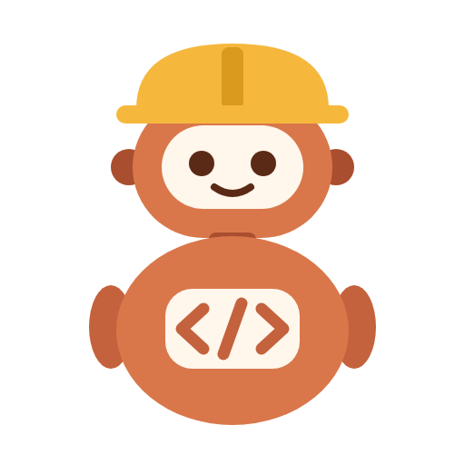
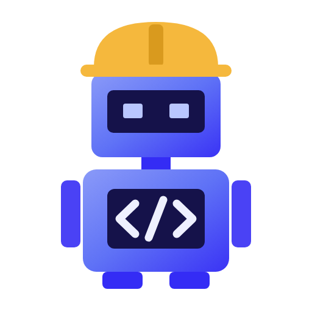

<p align="center">
  
  
</p>

# issue-worker-bots

Two GitHub Apps, `claude-dev-gh` and `codex-dev-gh`, that will pick up issues in Kenny's repositories, plan the work with a strong model, write the code with the cheapest model that fits, and open a pull request as a bot. Every pull request they open is reviewed by the other agent's review bot from [pr-review-bots](https://github.com/kennylhilljr/pr-review-bots).

## Status

Design stage. [`DESIGN.md`](DESIGN.md) describes the whole pipeline: which issues get picked up, the analysis and clarity gate, which model handles which step, budgets, and safety rules.

| Build step | State |
| --- | --- |
| 1. Worker Apps registered (`claude-dev-gh`, `codex-dev-gh`) | Done. Installed on all of Kenny's repositories with contents, issues and pull requests read and write. |
| 2. Intake watcher | Live: launchd runs it every 5 minutes. Trusts Kenny and `openclaw-ops-assist[bot]`; the 6 issues open at install were skipped. |
| 3. Analysis step | Not started |
| 4. Clarity gate, approval, orchestrator runs, draft PRs | Not started |
| 5. Review hand-off and repair round | Not started |
| 6. More repositories and model tuning | Not started |

## Intake (step 2)

`iwb intake` makes one pass over open issues on every repository the worker bots are installed on. An issue is picked up when it was opened by Kenny or by an account in `trusted_openers`, or when Kenny himself added the `bot:work` label. Issues labeled `bot:skip`, issues assigned to a person, and pull requests are left alone. The chosen worker bot adds `bot:queued` and posts one comment; nothing else happens until step 3.

The worker is chosen by an `agent:claude` or `agent:codex` label, otherwise the two alternate. Each issue is picked up once: a hidden marker in the bot's comment prevents a second pick-up even if the state file is lost. A pass picks up at most 5 issues.

```bash
./iwb intake --dry-run
```

Trust more openers, for example Kenny's own ops bot, in `~/.config/issue-worker-bots/config.json`:

```json
{"trusted_openers": ["openclaw-ops-assist[bot]"]}
```

Run it every 5 minutes with launchd. To skip the issues already open, run `./iwb intake --baseline` once first.

```bash
./install-intake.sh
```

Log: `~/Library/Logs/issue-intake.log`. State: `~/.config/issue-worker-bots/state.json`. Remove the job with `./install-intake.sh --uninstall`. Tests: `python3 -m unittest discover -s tests`.

## Layout

| Path | Contents |
| --- | --- |
| [`DESIGN.md`](DESIGN.md) | The design. |
| `bots/` | App specs for `prbot register --spec`, including each App's permissions. |
| `logos/` | Bot logos: SVG sources and 512 px PNGs uploaded to GitHub. |
| `iwb` | The CLI. Standard library only; uses `prbot` for sign-in and tokens. |
| `install-intake.sh` | Installs the launchd job that runs `iwb intake` every 5 minutes. |
| `tests/` | Unit tests for the pick-up rules, with fake GitHub data. |

## Depends on

- [openclaw-ecc-orchestrator](https://github.com/kennylhilljr/openclaw-ecc-orchestrator): plans, routing by tier, worktrees, escalation and budgets.
- [pr-review-bots](https://github.com/kennylhilljr/pr-review-bots): `prbot` for App identities, tokens, commits, pushes and cross-review.
