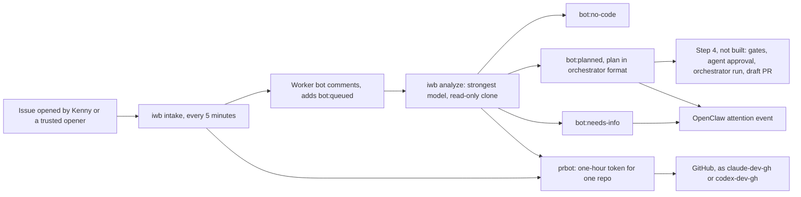

<p align="center">
  
  
</p>

<p align="center">
  
  
  
  
</p>

# issue-worker-bots

Two GitHub Apps, `claude-dev-gh` and `codex-dev-gh`, and the tooling around them, that pick up issues in Kenny's repositories, plan the work with a strong model, and, once coding is built, write it with the cheapest model that fits and open a pull request as a bot. Every pull request they open is reviewed by the other agent's review bot from [pr-review-bots](https://github.com/kennylhilljr/pr-review-bots).

Everything runs locally through one command, `iwb`, on a launchd timer. It signs in through `prbot`, so every comment, label and commit shows a bot, never Kenny. [`DESIGN.md`](DESIGN.md) describes the whole pipeline and the reasoning behind each choice.

## Project status

Intake and analysis are live on all of `kennylhilljr`'s repositories. Coding is designed but not built, so an issue stops at a posted plan for now.

| Build step | Status |
| --- | --- |
| 1. Worker Apps (`claude-dev-gh`, `codex-dev-gh`) | Done. Installed on all of Kenny's repositories with contents, issues and pull requests read and write. |
| 2. Intake watcher | Live: launchd runs it every 5 minutes. Trusts Kenny and `openclaw-ops-assist[bot]`; the 6 issues open at install were skipped. |
| 3. Analysis step | Live: launchd runs `tick` (intake, then one analysis) every 5 minutes. |
| 4. Clarity, policy and red-check gates, agent plan approval, orchestrator runs, draft PRs | Designed (no human approval; the other agent approves). Not built. |
| 5. Review hand-off and repair round | Not started. |
| 6. More repositories and model tuning | Not started. |

## Architecture



Reads go through the worker bot's token too, so the bots see exactly the repositories they are installed on.

## Requirements

| Dependency | Required | Purpose |
| --- | --- | --- |
| Python 3.9 or newer | Yes | Runs `iwb` and the tests. |
| [pr-review-bots](https://github.com/kennylhilljr/pr-review-bots) | Yes | `prbot` signs in as the worker Apps and supplies tokens. Expected next to this repository, or set `PRBOT_PATH`. |
| `gh` (GitHub CLI) | Yes | Every read and post goes through it. |
| `openssl` | Yes | Signs the App login (RS256), through `prbot`. |
| macOS Keychain (`security`) and launchd | Yes, for the timer | Hold the App keys and run `iwb tick` every 5 minutes. |
| `claude` CLI | For Claude analysis | Runs `opus` at high effort, read-only. |
| `codex` CLI | For Codex analysis | Runs `gpt-6-astra` at high effort, read-only. |
| [openclaw-ecc-orchestrator](https://github.com/kennylhilljr/openclaw-ecc-orchestrator) | For OpenClaw events now, coding later | Its event writer carries plans and questions to OpenClaw; its runs will do the coding in step 4. |

There are no third-party Python packages. The tests use the standard-library `unittest` runner.

## Install and run locally

Clone the repository next to `pr-review-bots` in `~/Documents/GitHub`:

```bash
git clone https://github.com/kennylhilljr/issue-worker-bots.git ~/Documents/GitHub/issue-worker-bots
```

Run the tests before first use:

```bash
cd ~/Documents/GitHub/issue-worker-bots && python3 -m unittest discover -s tests -v
```

### Register the worker Apps (once)

The App specs, including each App's permissions, are in `bots/`. `prbot` registers them and stores the private keys in Keychain:

```bash
prbot register claude-dev --spec bots/claude-dev.json
```

```bash
prbot register codex-dev --spec bots/codex-dev.json
```

Then install each App on your repositories and upload its logo from `logos/` on the App's settings page.

### Trust more openers

Kenny's own issues are always picked up. Add other accounts, for example Kenny's ops bot, in `~/.config/issue-worker-bots/config.json`:

```json
{"trusted_openers": ["openclaw-ops-assist[bot]"]}
```

### Start the timer

To skip the issues already open, mark them as seen once before installing the job:

```bash
./iwb intake --baseline
```

Then install the launchd job, which runs `iwb tick` every 5 minutes:

```bash
./install-intake.sh
```

Log: `~/Library/Logs/issue-intake.log`. State: `~/.config/issue-worker-bots/state.json`. Saved plans: `~/.config/issue-worker-bots/plans/`. To remove the job, run `./install-intake.sh --uninstall`.

## How an issue is handled

### Intake

`iwb intake` makes one pass over open issues on every repository the worker bots are installed on. An issue is picked up when Kenny or an account in `trusted_openers` opened it, or when Kenny himself added the `bot:work` label. Issues labeled `bot:skip`, issues assigned to a person, and pull requests are left alone. The chosen worker bot adds `bot:queued` and posts one comment.

The worker is chosen by an `agent:claude` or `agent:codex` label; otherwise the two alternate. Each issue is picked up once: a hidden marker in the bot's comment prevents a second pick-up even if the state file is lost. A pass picks up at most 5 issues.

### Analysis

`iwb analyze` takes one picked-up issue per pass, clones its repository read-only with the worker bot's token, and runs the worker's strongest model on it (override the models in `config.json` under `analysis_models`). Only the issue and comments from Kenny, trusted openers and the worker bots go into the prompt; other people's comments are left out.

The model answers with exactly one of:

| Answer | Posted as | Label |
| --- | --- | --- |
| No code change needed | The reason | `bot:no-code` |
| Questions | Up to 5 questions | `bot:needs-info` |
| A plan | A unit table plus the full plan in orchestrator format, saved to `~/.config/issue-worker-bots/plans/` | `bot:planned` |

Plans are checked before posting: 1 to 8 units, unique ids, every work-unit field present, files and acceptance commands on every unit, dependencies that exist. Two unusable answers mark the issue `bot:blocked`; removing that label tries again. A model failure such as a usage limit retries after an hour.

### Talking to the bots

Comment on an issue the bots picked up. Comments from Kenny and trusted openers are read on the next pass; everyone else's are ignored.

| Comment | What happens |
| --- | --- |
| `resume`, `continue`, `go`, `proceed`, `approve`, `lgtm` | The bot answers with where things stand. No model run. |
| `replan` | A fresh analysis. |
| `status` | The bot reports its last analysis. |
| `stop` | The bot adds `bot:stop` and does nothing more until it's removed. |
| Anything else | Treated as feedback: questions get answered, a plan gets revised. |

Commands may be prefixed with `@claude-dev-gh` or `@codex-dev-gh`. Editing the issue's title or body, switching `agent:claude` and `agent:codex`, and reopening the issue also bring the bot back. `"paused": true` in `config.json` stops all workers. The full list of triggers is under "Coming back to an issue" in [`DESIGN.md`](DESIGN.md).

### OpenClaw

Plans ready, questions posted and blocked issues appear in OpenClaw as `attention.required` events under one `github` run (Phase A of the bridge in [`DESIGN.md`](DESIGN.md)). They go through the orchestrator runtime's own event writer via `prbot`, and are skipped quietly if the runtime is not installed. No-code answers and dry runs send nothing.

## CLI reference

| Command | What it does |
| --- | --- |
| `iwb tick` | What launchd runs: intake, then one analysis. |
| `iwb intake [--dry-run] [--baseline] [--limit N]` | One pass over open issues; picks up at most N (default 5). `--dry-run` prints and saves nothing; `--baseline` marks the open issues as seen without commenting. |
| `iwb analyze [--dry-run] [--limit N]` | Analyzes up to N picked-up issues (default 1) and posts a no-code answer, questions or a plan. |

Status labels: `bot:queued`, `bot:no-code`, `bot:needs-info`, `bot:planned` and `bot:blocked` today; `bot:approved`, `bot:in-progress`, `bot:pr-open`, `bot:done` and `bot:stale` arrive with the later steps. `bot:stop` is set by Kenny.

## Repository layout

| Path | Contents |
| --- | --- |
| `iwb` | The CLI. Standard library only; uses `prbot` for sign-in and tokens. |
| `install-intake.sh` | Installs the launchd job that runs `iwb tick` every 5 minutes. |
| `bots/` | App specs for `prbot register --spec`, including each App's permissions. |
| `logos/` | Bot logos: SVG sources and 512 px PNGs uploaded to GitHub. |
| `tests/` | Unit tests for the pick-up and analysis rules, with fake GitHub data. |
| [`DESIGN.md`](DESIGN.md) | The design: pipeline, model choice, budgets, safety and the OpenClaw bridge. |

## Security boundaries

- Only issues opened by Kenny or a trusted opener, or labeled `bot:work` by Kenny, are worked on.
- Analysis runs read-only on a fresh clone. Coding, once built, runs only inside orchestrator worktrees, never on `main` or a checkout Kenny uses.
- Workers never merge, never push to the default branch, and never change repository settings, secrets or workflows. In step 4 a policy gate refuses plans that touch `.github/workflows`, secrets, credentials or deploy configuration; no agent can approve them.
- Tokens come from `prbot`: one hour, one repository, never printed or saved. App private keys live in macOS Keychain.
- The `pr-review-bots` guard hook and `cross-review` skill stop agents from posting or pushing as Kenny.

## Troubleshooting

### An issue is never picked up

Check that Kenny or a trusted opener opened it, or that Kenny added `bot:work`. Issues that were open when intake was installed were marked as seen by `--baseline` and are never picked up; open the issue again as a new one. `./iwb intake --dry-run` shows what the next pass would do.

### A comment did not bring the bot back

Only comments from Kenny and trusted openers count. Comments from other bots, including `claude-pr-gh[bot]`, are ignored. Edit the issue's body or post the comment as Kenny.

### The plan is ready but nothing happens

Coding is step 4, which is not built yet. The bot says so when asked to `resume`. Until then, a plan can be carried out by hand or through an orchestrator run.

### An analysis keeps failing

A usage limit or outage retries after an hour. Two unusable answers mark the issue `bot:blocked`; remove the label to try again. The log is `~/Library/Logs/issue-intake.log`.

## Contributing

Run the tests before every change and add a regression test for every bug found. Keep `iwb` to the standard library. Agents commit and push with `prbot git <bot> -- commit` and `-- push`, so GitHub attributes the work to a bot rather than to Kenny.

Depends on [openclaw-ecc-orchestrator](https://github.com/kennylhilljr/openclaw-ecc-orchestrator) for plans, routing by tier, worktrees, escalation and budgets, and on [pr-review-bots](https://github.com/kennylhilljr/pr-review-bots) for App identities, tokens, commits, pushes and cross-review.
