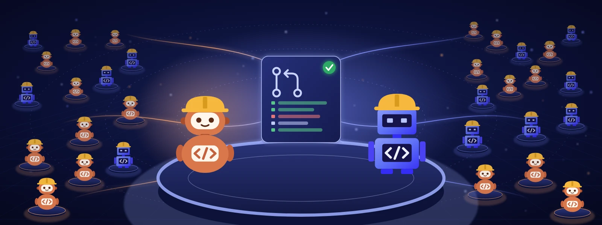
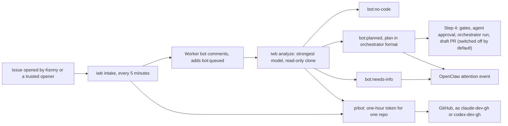

<p align="center">
  
  
  
  
</p>

# issue-worker-bots

Two GitHub Apps, `claude-dev-gh` and `codex-dev-gh`, and the tooling around them, that pick up issues in Kenny's repositories, plan the work with a strong model, and, once coding is built, write it with the cheapest model that fits and open a pull request as a bot. Every pull request they open is reviewed by the other agent's review bot from [pr-review-bots](https://github.com/kennylhilljr/pr-review-bots).

Everything runs locally through one command, `iwb`, on a launchd timer. It signs in through `prbot`, so every comment, label and commit shows a bot, never Kenny. [`DESIGN.md`](DESIGN.md) describes the whole pipeline and the reasoning behind each choice.

## Project status

Intake and analysis are live on all of `kennylhilljr`'s repositories. Plan approval (step 4a) and coding (step 4b) are built but switched off until `approval_live` and `coding_live` are set, so an issue stops at a posted plan for now.

| Build step | Status |
| --- | --- |
| 1. Worker Apps (`claude-dev-gh`, `codex-dev-gh`) | Done. Installed on all of Kenny's repositories with contents, issues and pull requests read and write. |
| 2. Intake watcher | Live: launchd runs it every 5 minutes. Trusts Kenny and `openclaw-ops-assist[bot]`; the 6 issues open at install were skipped. |
| 3. Analysis step | Live: launchd runs `tick` (intake, then up to three analyses at once) every 5 minutes. |
| 4. Clarity, policy and red-check gates, agent plan approval, orchestrator runs, draft PRs | 4a, gates and approval: built, runs when `approval_live` is set. 4b, coding and draft PRs: built and tested with fakes, pilot on `kennylhilljr/ecc-customization`, not yet run live; runs when `coding_live` is set. |
| 5. Review hand-off, repair round and gated merge | Built and tested with fakes; runs when `auto_merge` is set (with `coding_live`). |
| 6. More repositories and model tuning | Not started. |

## Architecture



Reads go through the worker bot's token too, so the bots see exactly the repositories they are installed on.

## Requirements

| Dependency | Required | Purpose |
| --- | --- | --- |
| Python 3.9 or newer | Yes | Runs `iwb` and the tests. |
| [pr-review-bots](https://github.com/kennylhilljr/pr-review-bots) | Yes | `prbot` signs in as the worker Apps and supplies tokens. Expected next to this repository, or set `PRBOT_PATH`. |
| `gh` (GitHub CLI) | Yes | Every read and post goes through it. |
| `openssl` | Yes | Signs the App login (RS256), through `prbot`. |
| macOS Keychain (`security`) and launchd | Yes, for the timer | Hold the App keys and run `iwb tick` every 5 minutes. |
| `claude` CLI | For Claude analysis | Runs `opus` at high effort, read-only. |
| `codex` CLI | For Codex analysis | Runs `gpt-6-astra` at high effort, read-only. |
| [openclaw-ecc-orchestrator](https://github.com/kennylhilljr/openclaw-ecc-orchestrator) | For OpenClaw events now, coding later | Its event writer carries plans and questions to OpenClaw; its runs will do the coding in step 4. |

There are no third-party Python packages. The tests use the standard-library `unittest` runner.

## Install and run locally

Clone the repository next to `pr-review-bots` in `~/Documents/GitHub`:

```bash
git clone https://github.com/kennylhilljr/issue-worker-bots.git ~/Documents/GitHub/issue-worker-bots
```

Run the tests before first use:

```bash
cd ~/Documents/GitHub/issue-worker-bots && python3 -m unittest discover -s tests -v
```

### Register the worker Apps (once)

The App specs, including each App's permissions, are in `bots/`. `prbot` registers them and stores the private keys in Keychain:

```bash
prbot register claude-dev --spec bots/claude-dev.json
```

```bash
prbot register codex-dev --spec bots/codex-dev.json
```

Then install each App on your repositories and upload its logo from `logos/` on the App's settings page.

### Trust more openers

Kenny's own issues are always picked up. Add other accounts, for example Kenny's ops bot, in `~/.config/issue-worker-bots/config.json`:

```json
{"trusted_openers": ["openclaw-ops-assist[bot]"]}
```

### Start the timer

To skip the issues already open, mark them as seen once before installing the job:

```bash
./iwb intake --baseline
```

Then install the launchd job, which runs `iwb tick` every 5 minutes:

```bash
./install-intake.sh
```

Log: `~/Library/Logs/issue-intake.log`. State: `~/.config/issue-worker-bots/state.json`. Saved plans: `~/.config/issue-worker-bots/plans/`. State and plans are written through a temporary file and a rename; a state file that still isn't a JSON object when read again under `state.lock` is moved aside to `state.json.corrupt-<UTC time>` with a log line, and the pass starts empty. An approved plan whose file is missing or malformed fails only that issue; its event is deferred. To remove the job, run `./install-intake.sh --uninstall`.

### Event-driven intake (proposed)

OpenClaw's github-event-router can drop one JSON file per GitHub issue event into `~/.local/state/github-events/iwb/`. `iwb tick --from-queue <folder>` runs intake, analysis and approval for just the issues named there, reading each issue fresh from GitHub. Once a stage holds, defers or fails an issue, the later stages skip it for that run. The queue job never codes: an issue whose approved plan is ready to code (with `coding_live` set) gets a hand-off file, the same event with `"stage": "code"` and the installed repository's own name, in `~/.local/state/github-events/iwb-code/`, and `iwb code --from-queue <folder>` drains that queue under `work.lock`. An issue that already has a valid coding hand-off waiting in that queue or its `-deferred` folder (matched by content: `"kind": "issue"`, `"stage": "code"`, the same repository and issue number; symlinks, malformed and unreadable files never count) gets no second one; the run logs `hand-off already pending`. Right before any new coding starts, on every path (the code job, the hourly `tick`, a manual `iwb code`) and while holding `work.lock`, `iwb` reads the issue and its trusted comments again. An issue closed in the meantime is not coded. If the title or body changed, or a trusted comment came after the analysis, the plan is out of date: `iwb` first records `stale_plan` on the issue's state entry, so approval and coding refuse it on every path (the code job, the hourly `tick`, a manual `iwb code`) until a new analysis clears it. Then it sends an event (`"event": "stale-plan"`) back into the issue queue, which analyzes the issue again; a code-queue hand-off for it is deleted. The `stale_plan` record carries `"notified": false` until that event is written; if writing it fails, the hand-off is deferred instead and the next coding pass sends the event again (a busy `work.lock` keeps the hand-off waiting). `notified` is set under `state.lock` only while the record is still the one written, so an analysis that cleared or replaced it meanwhile is never undone.

When the router sees a post from an allowed GitHub app but can't tell which issue it is about, it writes a sweep request into the issue queue: a uniquely named file such as `sweep-20261103T150000000Z-3fa9c1.json` with `"kind": "sweep"` and `"repo"` set to one repository or null. A sweep file without a `"repo"` key is rejected, not taken as a sweep of every repository. `iwb` recognizes sweeps by that content, not by the file name. All sweep files a run finds become one pass, and the run deletes exactly those; a sweep that arrives during the pass waits for the next run. A sweep runs the hourly pass (intake, analysis, and approval when `approval_live` is set, sharing whatever is left of the run's per-pass limits after the queued issues) for that repository, or for every repository when `repo` is null, after the run's queued issues. If a limit stops some of the sweep's work, the sweep file stays in the queue untouched and the next run, a minute later, sweeps again. Issues that become ready to code get hand-offs; the sweep never codes. It is deleted once the pass ran, deferred with an attempt when the pass failed or a repository could not be listed, and rejected when it names a repository the bots aren't installed on. A failure of a single issue inside the pass is left to that issue's own retry, as in the hourly `tick`.

launchd starts each queue job again, at most once a minute, for as long as its folder holds anything. Every run deletes or moves out everything except issues held back by a per-pass limit, and a run's first issue is never held back. Each queue has two folders next to it (shown for the issue queue; the code queue's are `iwb-code-deferred/` and `iwb-code-rejected/`):

| Folder | What goes there |
| --- | --- |
| `~/.local/state/github-events/iwb/` | New events from the router, and the untouched files of issues that only hit a per-pass limit (`analysis_concurrency` analyses per run, for example). Those are taken first on the next run. |
| `~/.local/state/github-events/iwb-deferred/` | Files of an issue whose step failed, even when the step caught the error itself (a model, post or push failure; the run exits 1), or whose GitHub read failed (exit 0). Each such move adds 1 to an `attempts` field in the file. Issues waiting for capacity, a pause or a delay also go here, without counting an attempt: every queued event and sweep while `"paused": true` is set in `config.json`, another pass holding `work.lock` (only for an issue that has coding to do), no free coding slot (`code_concurrency`, `max_parallel`, or a run already going in the repository), the hour after a model failure. The hourly `tick` moves them all back into their queue after its scan. |
| `~/.local/state/github-events/iwb-rejected/` | Anything that can never be handled: bad JSON, no valid repo or issue number, a pull request (including an issue event whose number turns out to be a pull request), a repository the bots aren't installed on, files deferred 24 times, and every other entry found in the queue: stray files such as `.DS_Store`, folders (moved whole, contents untouched) and symlinks (the link itself moves; its target is never followed or touched). Nothing reads or clears this folder; look through it and empty it by hand now and then. |

Handled issues' files are deleted. An empty or missing queue folder exits 0 without a log line. A burst of new issues larger than the per-pass limits drains one run at a time, about a minute apart: each run starts with a fresh budget, so its first issue always goes through, and the issues it couldn't reach stay in the queue for the next run. Plain `tick` reads the issue queue folder from `IWB_QUEUE_DIR`, with the path above as the default; the code queue is the folder next to it with `-code` added.

A queue folder is only touched if it is the default path, or its parent folder holds a regular file named `.github-events-queue`. The router creates that file in `~/.local/state/github-events/` with every write, and `iwb` creates it when it writes a hand-off. Any other folder, a folder that is a symlink, or a path that is not a folder is refused with exit 2 and left as it is. The same happens when the queue's `-deferred` or `-rejected` folder exists but is a symlink or a file (checked without following links). The hourly requeue skips such a queue with a log line.

[`launchd/`](launchd/README.md) holds the proposed jobs: the issue queue job and the code job, which launchd starts whenever their folders have entries, and the full-scan `tick` slowed to once an hour as a backstop. They are not installed by `install-intake.sh`; the steps and the rollback are in `launchd/README.md`.

Both forms of `tick` take `~/.local/state/issue-worker-bots/tick.lock` (non-blocking) for intake, analysis and approval, so the two jobs never run those steps at once. A run that finds the lock held logs a line and exits 0. A queue run then leaves the folder as it is, since the run holding the lock is active, and launchd starts it again a minute later. Coding passes, in the code job and in the hourly `tick`, take `work.lock`, so only one pass at a time chooses what to code; the runs themselves go on in their own processes (see "Parallel runs").

## How an issue is handled

### Intake

`iwb intake` makes one pass over open issues on every repository the worker bots are installed on. An issue is picked up when Kenny or an account in `trusted_openers` opened it, or when Kenny himself added the `bot:work` label. Issues labeled `bot:skip`, issues assigned to a person, and pull requests are left alone. The chosen worker bot adds `bot:queued` and posts one comment.

The worker is chosen by an `agent:claude` or `agent:codex` label; otherwise the two alternate. Each issue is picked up once: a hidden marker in the bot's comment prevents a second pick-up even if the state file is lost. A pass picks up at most 5 issues.

### Analysis

`iwb analyze` takes up to `analysis_concurrency` (default 3) picked-up issues per pass and runs their analyses at the same time. For each it clones its repository read-only with the worker bot's token, and runs the worker's strongest model on it (override the models in `config.json` under `analysis_models`). Only the issue and comments from Kenny, trusted openers and the worker bots, plus the review bots' plan verdicts, go into the prompt; other people's comments are left out.

The model answers with exactly one of:

| Answer | Posted as | Label |
| --- | --- | --- |
| No code change needed | The reason | `bot:no-code` |
| Questions | Up to 5 questions | `bot:needs-info` |
| A plan | A unit table plus the full plan in orchestrator format, saved to `~/.config/issue-worker-bots/plans/` | `bot:planned` |

Plans are checked before posting: 1 to 8 units, unique ids, every work-unit field present, files and acceptance commands on every unit, dependencies that exist, and a `budget.maximum_cost_usd` above 0 on every unit. The orchestrator treats that field as a hard limit per unit and stops a unit whose cost has reached it, so 0 or no value means the unit never gets a first attempt. The planner's example unit and prompt use `max_cost_usd_per_issue` from `config.json` (default 5) for it. Two unusable answers mark the issue `bot:blocked`; removing that label tries again. A model failure such as a usage limit retries after an hour.

In step 4a a plan can go back to the planner twice at most: once when `lint-plan` or the fixable gates reject it (a shell in an acceptance command, a unit cost limit of 0), and once when the reviewer answers `revise`. The two budgets are separate, so a plan that failed lint once still gets the reviewer's revision. A second send-back of the same kind marks the issue `bot:blocked`. A send-back that the per-pass analysis limit holds, or whose analysis fails, is still replanned on a later pass: the request is cleared only once a new analysis is posted. While a send-back is pending (the latest approval comment is "Plan needs changes" and no newer plan exists), the next analysis must post a revised plan or questions: its prompt says so, and a no-code answer counts as an unusable answer instead of labelling the issue `bot:no-code`. Only a new plan ends this state; questions answered in between or removing a label do not. If the tries run out that way, the issue gets `bot:needs-kenny` instead of `bot:blocked`; removing that label analyzes again and, unlike removing `bot:blocked`, keeps both send-back budgets. A state entry written before the split has only `revisions`, which counts as the reviewer's revision. Removing `bot:blocked` resets both budgets.

### Coding (step 4b)

`iwb code` takes the plans that step 4a approved, as many as there are free coding slots (see "Parallel runs") (the plan file must be unchanged since the approval) in a repository listed in `coding_repos`. The worker labels the issue `bot:in-progress` and runs the orchestrator in `iwb`'s own clone of the repository: `ecc review-plan --approve` with the approving review bot as operator, `ecc create-run --yes --review-id`, then the same pair for `ecc drive`, with `bot/<n>-<slug>` as the target branch. The branch is then fetched into a new repository that `iwb` makes (no hooks, no config from the clone or the home folder), where the changed files are checked against the plan's scope and the protected paths, committed once as the worker bot, and pushed to the `bot/` branch on `https://github.com/<owner>/<repo>` only. The clone the agents worked in never sees a token. A draft PR with `Closes #<n>` and `agent:claude` or `agent:codex` is opened and marked ready, so `prbot watch` reviews it, and the issue gets `bot:pr-open`. A run that stops, or changes a file it shouldn't, gets `bot:blocked` and nothing is pushed. An approved plan with a unit whose `budget.maximum_cost_usd` is 0 or missing is never handed to `create-run`: it could only stop with `needs_owner`. The approval pins the plan file, so `iwb` leaves it as it is and labels the issue `bot:blocked`; removing the label replans the issue. Nothing is merged here; step 5 below decides that.

Settings in `~/.config/issue-worker-bots/config.json`; nothing is coded until both of the first two are set:

```json
{
  "coding_live": true,
  "coding_repos": ["kennylhilljr/ecc-customization"],
  "policy": {"kennylhilljr/ecc-customization": ["bootstrap.sh", "stack.conf", "machine/**"]},
  "ecc_config": {"certifications": "~/.local/share/openclaw-ecc-orchestrator/runtime/.orchestration/runtime/cert-latest.json"}
}
```

| Key | Default | Meaning |
| --- | --- | --- |
| `coding_live` | false | `tick` runs `iwb code`. |
| `coding_repos` | none | Repositories where approved plans are coded. Elsewhere the worker posts one note and the plan waits. |
| `auto_merge` | false | Step 5 in each coding pass: one repair round on P0-P2 findings, then the gated squash merge (see above), for PRs in `coding_repos`. |
| `test_commands` | none | `{"owner/repo": ["command", ...]}`: run on the PR head with the plan's acceptance commands before a merge. Run without a shell, sandboxed, with no network. |
| `policy` | the seed list above for `ecc-customization` | Protected globs per repository, read the same way by the plan gate and the check after the run, on top of `.github/workflows/**`, `**/.env*`, `**/*.pem`, `**/*.key`, `**/secrets/**`, credentials and SSH key names. The older `{"deny_paths": [regex], "allow_paths": [regex]}` form also works; `allow_paths` never opens a built-in path. Either form replaces the seed list. A malformed entry (another key, an empty pattern, a bad regex) protects every path. |
| `ecc_config` | certifications and catalog from the orchestrator runtime | Orchestrator config keys for the run (for example `repo_checks`). Coding waits, without posting, while the certifications file is missing. |
| `code_concurrency` | 4 | Coding and repair runs going at once, across all repositories. |
| `max_parallel` | 3 | Of those, the most one runner CLI (`claude` or `codex`) codes at once. |
| `runner_fallback` | false | When the runner that would code a plan is at its usage limit, the other runner codes it instead of waiting, whatever the plan's approver; the PR's cross-review comes from the family other than the runner that wrote the code (see below). |
| `analysis_concurrency` | 3 | Analyses per pass, run at the same time. |

#### Parallel runs

A coding pass (`iwb code`, the hourly `tick`, the code queue job) holds `work.lock` only while it chooses work. It starts each coding run and each repair round as its own process, `iwb code --job <file>`, and returns; the run then goes on for hours without the lock. Each run holds two locks under `~/.local/state/issue-worker-bots/locks/` for its whole life, its issue's and its repository's, which the pass takes before starting the process and the process inherits, so the kernel releases them when the run ends however it ends. That gives at most `code_concurrency` runs, at most `max_parallel` per runner, and never two runs in one repository. An issue labeled `bot:in-progress` whose issue lock is free has lost its run and is blocked as interrupted; one whose lock is held is left alone. When a run ends it starts a coding pass of its own (with `coding_live`), so a freed slot is used at once and open PRs are looked at. Merges (step 5) still run inside the pass, one at a time under `work.lock`. Each run saves only the fields of its own issue's state entry that it changed, under `state.lock`, so runs and passes saving at once keep each other's changes.

With `runner_fallback`, a plan whose runner hit its usage limit (the "Coding paused" note) is handed to the other runner on the next pass, and the "Coding started" comment says so. The plan's approver does not matter: a `codex` plan approved by `claude-pr-gh` can be coded by `claude`, and a `claude` plan approved by `codex-pr-gh` by `codex`. What keeps the families apart is the PR's review, not the plan's approval. The worker bot and its branch stay the same; the PR is labeled `agent:<runner>` with the runner that wrote the code, so its cross-review comes from the other family than that runner and the merge waits for that review (if that family is still at its usage limit, the merge waits for its reset; code is never reviewed by its author's family), and its repair round is written by that runner too (it waits for that runner's reset rather than switching). A run that failed because a reviewing runner (not the author) hit its limit waits for that runner's reset before the issue is tried again.

### Review, repair and gated merge (step 5)

With `"auto_merge": true`, every coding pass (under `work.lock`, after any coding) looks at each issue whose PR is open. The gated rule: a worker's PR is squash-merged by `iwb`, as the worker bot and only while its head is the reviewed commit, when all of these hold: it is the worker bot's own non-draft PR from a `bot/` branch and GitHub can merge it cleanly; the latest cross-review by the other agent's review bot reviewed the head commit and has no P0, P1 or P2 findings (P3 findings pass and are listed in the merge comment; a sentence saying there are none, such as "No P1 or P2 findings", is not a finding); the plan's acceptance commands and the repository's `test_commands` pass on a fresh clone of the head (none determinable means no merge); no changed file is a protected path; and no check run or commit status on the head is failing or pending. If the review of the head has P0-P2 findings and no repair round has run for the PR, the worker runs one: each finding becomes an orchestrator unit with the finding as its instructions (and a test for the failing case it describes as part of the work), the plan's files as scope, the plan's acceptance commands as acceptance, and the tier of the plan units it names. The round starts from the PR head in `iwb`'s own clone, goes through the same scope and protected-path check, and is pushed as one more commit by the worker bot to the same `bot/` branch, where `prbot watch` reviews the new head. No review of the head yet, checks still running, or GitHub still computing mergeability means the PR waits for a later pass. Anything else (findings left after the repair round, a failed repair, a failing command, a protected path, a failing check, a conflict, a PR that isn't the worker's) labels the issue `bot:needs-kenny` with one paragraph saying why, and `iwb` does nothing more with it. After a merge the issue gets a comment and `bot:done`; a PR Kenny merges himself gets the same. A closed issue gets no repair round, merge or hand-off, and before a failed repair round or acceptance run hands the PR to Kenny, `iwb` reads the PR and issue again: a PR merged meanwhile gets `bot:done` instead of `bot:needs-kenny`. One merge (with its acceptance run) per pass; a repair round counts as the pass's coding run. `bot:stop` on the issue or `"paused"` leaves the PR alone.

Each run also gets an orchestrator policy, `~/.local/state/issue-worker-bots/repos/<owner>__<repo>.policy.json`, passed as `--policy-file`. The worker's own CLI authors (`author_providers`), Claude and Codex may review (`allowed_providers`, with `review_independence: persona`), and `cli_models` names each tier's model from DESIGN.md "Model choice". Budgets follow `max_cost_usd_per_issue`. Without a policy the orchestrator has no Tier 0 model, and every run stopped with `no eligible certified runner for tier 0 (economical) as author`. A repository's own `.orchestration/config.yaml`, or `policy_file` in `ecc_config`, replaces it.

The orchestrator is `../openclaw-ecc-orchestrator/bin/ecc` (override with `IWB_ECC`). Before coding, `iwb` fetches that checkout (or `ecc_path` from `config.json`). If it is on branch `main`, has no changes to tracked files (untracked files are fine) and is only behind `origin/main`, `iwb` fast-forwards it with `git merge --ff-only` and logs it. Otherwise, if `HEAD` is not `origin/main`, coding waits with a log line saying so; `iwb` never resets, stashes or switches branches there. Its state, worktrees and `iwb`'s clones live in `~/.local/state/issue-worker-bots/` (override with `IWB_WORK`), apart from Kenny's own orchestrator runs.

### Talking to the bots

Comment on an issue the bots picked up. Comments from Kenny and trusted openers are read on the next pass; everyone else's are ignored.

| Comment | What happens |
| --- | --- |
| `resume`, `continue`, `go`, `proceed`, `approve`, `lgtm` | The bot answers with the issue's current state: waiting for approval, approval or coding switched off, coding running or stopped, or a PR open or merged. No model run. |
| `replan` | A fresh analysis. The command counts as handled only once that analysis is posted, so a pass the analysis limit holds, or one where the model fails, tries again later. |
| `status` | The bot reports its last analysis. |
| `stop` | The bot adds `bot:stop` and does nothing more until it's removed. |
| Anything else | Treated as feedback: questions get answered, a plan gets revised. |

Commands may be prefixed with `@claude-dev-gh` or `@codex-dev-gh`. Editing the issue's title or body, switching `agent:claude` and `agent:codex`, and reopening the issue also bring the bot back. `"paused": true` in `config.json` stops all workers. The full list of triggers is under "Coming back to an issue" in [`DESIGN.md`](DESIGN.md).

### OpenClaw

Plans ready, questions posted and blocked issues appear in OpenClaw as `attention.required` events under one `github` run (Phase A of the bridge in [`DESIGN.md`](DESIGN.md)). They go through the orchestrator runtime's own event writer via `prbot`, and are skipped quietly if the runtime is not installed. No-code answers and dry runs send nothing.

## CLI reference

| Command | What it does |
| --- | --- |
| `iwb tick` | What launchd runs: intake, then up to `analysis_concurrency` analyses at once, then step 4a when `approval_live` is set and step 4b when `coding_live` is set. |
| `iwb tick --from-queue DIR` | Intake, analysis and approval for only the issues named by event files in `DIR`, each once per run; hands issues ready to code to `DIR-code`. Deletes a handled issue's files and moves the rest to `DIR-deferred` or `DIR-rejected`. Exits 1 if an issue failed, 2 if `DIR` is not a queue folder. |
| `iwb code --from-queue DIR` | Codes the issues handed off in `DIR`, with the same deferred and rejected folders. |
| `iwb code [--dry-run]` | Starts a coding run for each approved plan that has a free slot (each run opens its PR), then (with `auto_merge`) runs step 5 on open worker PRs. `--dry-run` prints what it would do. |
| `iwb intake [--dry-run] [--baseline] [--limit N]` | One pass over open issues; picks up at most N (default 5). `--dry-run` prints and saves nothing; `--baseline` marks the open issues as seen without commenting. |
| `iwb analyze [--dry-run] [--limit N]` | Analyzes up to N picked-up issues at the same time (default `analysis_concurrency`, 3) and posts a no-code answer, questions or a plan. |
| `iwb scan [--repo owner/repo] [--force] [--dry-run]` | A read-only scan of the `scan_repos` repositories (or `--repo`) that files each improvement it finds as a `bot:proposed` issue, unless one already has its marker; see [iwb scan](#iwb-scan). |

Status labels: `bot:queued`, `bot:no-code`, `bot:needs-info`, `bot:planned`, `bot:approved`, `bot:in-progress`, `bot:pr-open`, `bot:needs-kenny`, `bot:done` and `bot:blocked`; `bot:stale` is not built yet. `bot:stop` is set by Kenny. `bot:proposed` marks an issue `iwb scan` filed.

### iwb scan

`iwb scan [--repo owner/repo] [--force] [--dry-run]` runs a read-only model pass over a repository and files every improvement it finds as an issue: stale docs and comments, behavior with no test, dead code and unused config, missing CI checks, outdated or vulnerable dependencies, and missing or stale agent setup. It never changes code or opens PRs. The scan itself writes nothing to GitHub; only the filing step opens issues.

- **Which repositories.** Only those listed in the `scan_repos` key of `config.json`. Scanning is off by default: without `scan_repos` nothing is scanned on a schedule.
- **How often.** Each repository at most once every `scan_interval_days` (default 7).
- **Scheduled.** `iwb tick` scans the first repository in `scan_repos` order that is due, at most one per pass, after approval. Nothing is scanned while `config.json` has `paused`.
- **By hand.** `iwb scan` scans every repository in `scan_repos`, ignoring the interval. `--repo owner/repo` scans just that one, even if it isn't listed. `--force` also ignores the backoff after a failure. `--dry-run` prints the kept findings as JSON and the issues it would file, posts nothing and saves no state. Exits 1 if a scan failed or a finding was skipped.
- **When a scan is due.** The state file keeps `state["_scan"][repo] = {at, failed_at, next_eligible_at}`. The first rule that applies wins:
  1. With `--force`, the scan always runs.
  2. After a clone, model, issue-read or filing failure, `failed_at` makes the next scan, scheduled or by hand, wait one hour.
  3. Two unusable answers in the same run set `next_eligible_at` one interval ahead. Scheduled scans wait for it; `iwb scan` by hand does not.
  4. Otherwise a scheduled scan waits the interval after `at`, the last usable scan whose findings were all filed.
- **Read-only.** The worker bots take turns. Claude runs with only `Read Grep Glob` and no MCP servers (`--strict-mcp-config`). Codex runs with `-s read-only`. Both run in `iwb`'s own clone, which is removed afterwards.
- **Recent review findings.** The model also gets the P1 and P2 findings from bot reviews and inline review comments on the repository's pull requests in the last 90 days. A comment's own `created_at` decides, or `submitted_at` for a review. Only comments by the logins in `config.json` `scan.review_bot_logins` count; the default is `["claude-pr-gh[bot]", "codex-pr-gh[bot]"]`. They are a compact list, newest first: PR, link, severity and a one-line summary, cut to 4000 characters. When the same kind of bug shows up more than once, the model is asked for a `repeat-review` finding that proposes the lint rule, hook or test that would stop it, with the review links as evidence. If the reviews can't be read, the scan logs one line and runs without them.
- **What is kept.** Only findings with confidence at least 80. When two findings share a fingerprint, the one with the highest confidence is kept.
- **Filing.** The worker bot that ran the scan files every kept finding, highest confidence first, with no cap. Each issue is labeled `bot:proposed`. Its body holds the finding, evidence, why, the suggested change and acceptance, then the hidden marker `<!-- iwb-scan:<fingerprint> -->` and one hidden `<!-- iwb-scan-meta: {...} -->` block with the category, area and root cause. Model text is redacted, and any HTML comment in it is escaped, so it cannot fake a marker.
- **Combined findings.** The model may give findings the same `group` key. Two findings are compatible when they have the same category, and either the same area or the same non-null root cause. A group must be compatible in every pair. `iwb` keeps the largest valid subset of each proposed group, then the largest of the rest, and files whatever is left on its own. A combined issue lists its findings as a checklist, with each finding's own marker on its checklist line. A group holds at most 8 findings, because a plan has at most 8 units. Larger groups are split by area.
- **Appending.** A new finding, or a new group, is added as checklist items to an open issue only when all of these hold:
  - the scanner filed the issue in an earlier scan;
  - it is labeled `bot:proposed` and not `bot:work`;
  - it has room for 8 findings in total;
  - every existing member, read from the meta block and the markers, is compatible with every new finding.

  Candidates come from an issue search. When the search fails or offers no valid target, every issue is listed instead. An issue with `bot:work` is never edited, because its plan was approved against it, so the finding becomes a new issue.
- **Dedup by marker.** A finding is not filed again while any issue in that repository carries its marker, open or closed. Closing a proposal means "don't do it". Pull requests never count. Markers are checked against GitHub, not the state file, so an empty state file files nothing twice. Fingerprints are per repository. `iwb` first searches the issues for the marker and checks each hit's body for the exact marker. When the search fails or finds no exact match, it lists every issue in the repository once per scan and checks those. When that listing fails too, the finding is skipped this run: the scan logs it, sets `failed_at` and leaves `at` unchanged. A finding is never filed blind.
- **`bot:proposed` and intake.** Intake leaves `bot:proposed` issues, and any issue a worker bot opened, alone until Kenny adds `bot:work`. That holds even if the bot is listed in `trusted_openers`. `bot:proposed` is not a status label, so later status changes keep it.

## Repository layout

| Path | Contents |
| --- | --- |
| `iwb` | The CLI. Standard library only; uses `prbot` for sign-in and tokens. |
| `install-intake.sh` | Installs the launchd job that runs `iwb tick` every 5 minutes. |
| `launchd/` | Proposed plists for event-driven intake (issue queue job, code queue job, hourly backstop) and how to install or roll them back. |
| `bots/` | App specs for `prbot register --spec`, including each App's permissions. |
| `logos/` | Bot logos: SVG sources and 512 px PNGs uploaded to GitHub. |
| `docs/assets/` | The README header (SVG source and WebP). |
| `tests/` | Unit tests with fake GitHub, models and orchestrator: pick-up, analysis, plan approval, coding and label changes. |
| [`DESIGN.md`](DESIGN.md) | The design: pipeline, model choice, budgets, safety and the OpenClaw bridge. |

## Security boundaries

- Only issues opened by Kenny or a trusted opener, or labeled `bot:work` by Kenny, are worked on.
- Analysis runs read-only on a fresh clone. Coding runs only in repositories listed in `coding_repos`, inside orchestrator worktrees of `iwb`'s own clone, never on `main` or a checkout Kenny uses; its changes are checked against the plan's scope and protected paths before anything is pushed.
- Workers never push to the default branch except via a gated squash merge of a reviewed bot PR (step 5: clean cross-review of the head, acceptance passing on the head, no protected path, no failing check), and never change repository settings, secrets or workflows. In step 4 a policy gate refuses plans that touch `.github/workflows`, secrets, credentials or deploy configuration; no agent can approve them.
- Tokens come from `prbot`: one hour, one repository, never printed or saved. App private keys live in macOS Keychain.
- The `pr-review-bots` guard hook and `cross-review` skill stop agents from posting or pushing as Kenny.

## Troubleshooting

### An issue is never picked up

Check that Kenny or a trusted opener opened it, or that Kenny added `bot:work`. Issues that were open when intake was installed were marked as seen by `--baseline` and are never picked up; open the issue again as a new one. `./iwb intake --dry-run` shows what the next pass would do.

### A comment did not bring the bot back

Only comments from Kenny and trusted openers count. Comments from other bots, including `claude-pr-gh[bot]`, are ignored. Edit the issue's body or post the comment as Kenny.

### The plan is ready but nothing happens

A ready plan waits when `approval_live` is off, when `coding_live` is off, when the repository is missing from `coding_repos`, when the certifications file is missing, when the issue has `bot:stop`, or when config.json has `"paused": true`. Comment `status` and the bot's reply names the real state of the issue: which gate is closed, or whether coding is running, stopped or has a PR. Blocked, `bot:stop` and paused issues don't answer commands. The blocked comment explains a block, and removing `bot:blocked` restarts the issue from analysis.

### An analysis keeps failing

A usage limit or outage retries after an hour. Two unusable answers mark the issue `bot:blocked`; remove the label to try again. The log is `~/Library/Logs/issue-intake.log`.

## Contributing

Read [AGENTS.md](AGENTS.md) for agent safety and review rules.

Run `python3 scripts/check.py` before opening a PR.

Run the tests before every change and add a regression test for every bug found. Keep `iwb` to the standard library. Agents commit and push with `prbot git <bot> -- commit` and `-- push`, so GitHub attributes the work to a bot rather than to Kenny. Inside an `iwb code` run this rule applies to what is pushed, not to the orchestrator's worktree: `publish` squashes the run into one commit by the worker bot from a trusted copy, so the author of an intermediate worktree commit is not a delivery problem.

Depends on [openclaw-ecc-orchestrator](https://github.com/kennylhilljr/openclaw-ecc-orchestrator) for plans, routing by tier, worktrees, escalation and budgets, and on [pr-review-bots](https://github.com/kennylhilljr/pr-review-bots) for App identities, tokens, commits, pushes and cross-review.
